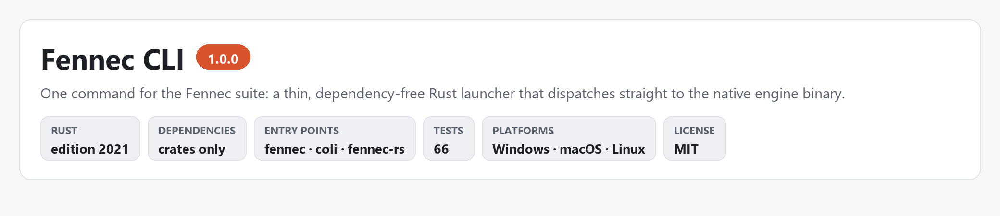

---

## At a glance

| Tests | Binaries built | Suite subcommands | `fennec --version` cold start | CI matrix |
|:---:|:---:|:---:|:---:|:---:|
| 66 in 2 files | 3 (`fennec`, `coli`, `fennec-rs`) | 6 | 10.6 ms median, 2.2 MB binary | 3 OS × cargo test + build + smoke |

One crate, no subfolders: `src/launcher.rs` is the product command, `src/glue.rs` is the
measured Rust form of the suite glue, and `src/bin/` gives them their three names. Counts
come from `cargo test --release` in this checkout and `.github/workflows/cli.yml`; the cold
start is 15 samples of the release binary on this machine (min 9.6 ms, one 113 ms outlier).
No inference code lives here: the engine is [Fennec](https://github.com/Liso7150/fennec),
a single Rust binary. `coli` is built as an alias because that was the legacy engine's
own entry-point name.

## Dispatch

```
 fennec <args>   (or: coli <args>)
      │
      ├─ suite verb? ──► setup · update · diagnose · preflight · acp · outlets
      │                  (preflight is answered in Rust; setup / acp / outlets
      │                   hand the process to fennec-core)
      │
      └─ otherwise ──► probe the configured engine root, in order:
                         1. target/release/fennec(.exe)  ─► run the binary directly
                         2. target/debug/fennec(.exe)    ─► run the binary directly
                         3. ./fennec(.exe)               ─► run the binary directly
                         4. c/coli · colibri/cli.py      ─► python <launcher>  (legacy)
                       argv unchanged · env seeded · exit code preserved
```

An unrelated `coli` on PATH is never redispatched, and relative arguments stay relative to
your shell. `--help` and `--version` work without an engine checkout.

## Install

The crate path-depends on the `fennec-core` crates, so check the two repos out side by side.
Requires Rust (cargo on PATH):

```bash
git clone https://github.com/Liso7150/fennec-core
git clone https://github.com/Liso7150/fennec-cli
cd fennec-cli && cargo install --path . --locked   # fennec, coli, fennec-rs onto PATH
```

Or just `cargo build --release` and use `target/release/`.

> [!NOTE]
> This is a source install, not a claim that the crate is published on crates.io. Use
> [fennec-installer](https://github.com/Liso7150/fennec-installer) to obtain and configure
> the engine itself. Do not install two different packages providing `coli` into the same
> environment. Models, inference binaries and GPU drivers are not bundled here.

## Suite commands

| Command | What it does |
|---|---|
| `fennec setup [--yes]` | detect Python/engine/models, write `~/.fennec/config.json` |
| `fennec update` | fast-forward installed suite checkouts |
| `fennec diagnose` | read-only: config, interpreter, engine, model, suite, TokenEconomizer |
| `fennec preflight --model <model-dir>` | weights + peak KV cache against this machine's memory (`--ctx`, `--kv-bytes`, `--json`) |
| `fennec acp` | speak ACP v1 on stdio, for editors |
| `fennec acp --check` | report what the ACP v1 agent advertises |
| `fennec outlets` | status of the optional Jev / OpenBot web-agent outlets |
| `fennec --help` / `--version` | launcher help and version, no checkout needed |

`setup`, `acp` and `outlets` hand the process to
[`fennec-core`](https://github.com/Liso7150/fennec-core), which must be importable — either
installed, or present as a sibling checkout. `preflight` is answered by the Rust
`fennec-preflight` crate in this same binary. `update`, `diagnose` and `outlets` take no
extra arguments.

> [!TIP]
> `fennec diagnose` is this launcher's own read-only check of the *suite*. `fennec doctor`
> is the *engine's* hardware and backend report. They answer different questions.

## Engine dispatch

Every other argument list is passed straight through, unchanged:

```bash
fennec serve --model <model-dir> --auto-tier --threads 8 --host 127.0.0.1 --port 8184
fennec run   --model <model-dir> --prompt "Explain MoE routing"
fennec plan  --model <model-dir>      # show device placement
fennec probe                          # enumerate devices and backends
fennec doctor                         # engine-side hardware/backend health
fennec decode --model <model-dir> --window 40 --tokens 32 --json
fennec bench --model <model-dir>
fennec quant --model <model-dir>
fennec info
```

Run `fennec --help` inside a configured checkout for the engine's full command and flag
list. Exit codes are preserved, so scripts and CI can trust the result.

## Configuration

The launcher reads `FENNEC_CONFIG` or `~/.fennec/config.json`. Without configuration it
tries `~/Fennec`, then `~/Colibri`, on every platform; the installer's chosen root or
`FENNEC_HOME` wins. No drive letter is assumed.

| Config key | Environment override |
|---|---|
| `engine_root` | `FENNEC_HOME` |
| `suite_root` | `FENNEC_SUITE` |
| `python` (Colibri fallback only) | `FENNEC_PYTHON` |
| `model` | `FENNEC_MODEL` |
| `cache_root` | `FENNEC_CACHE` |
| `backend` | — |

When dispatching, it also seeds the environment so both engines agree. Existing values are
never overwritten.

| Variable | Set from |
|---|---|
| `FENNEC_MODEL`, `COLI_MODEL` | `FENNEC_MODEL` or config `model` |
| `FENNEC_VULKAN`, `COLI_VULKAN` | config `backend` (`vulkan` → `1`, `cpu` → `0`) |
| `HF_HOME` | `<cache_root>/huggingface` |
| `PIP_CACHE_DIR` | `<cache_root>/pip` |

## The measured glue: `fennec-rs`

The third name in this crate is the runnable form of the ported suite glue. It is not a
user command; `fennec_core/rust_bridge.py` spawns `fennec-rs serve` and speaks NDJSON to it,
and `benchmarks/bench.py --impl rust` measures it.

```bash
fennec-rs --help                      # the whole surface
fennec-rs compact <transcript.json>   # bounded context, code points not UTF-16
fennec-rs urlgate <url>...            # allow/block, one line per url
fennec-rs elide <limit>               # stdin, head/tail elided to N characters
fennec-rs redact                      # stdin, Fennec's own redaction
fennec-rs preflight [DIR] --json      # the same budget the launcher's verb answers
fennec-rs serve                       # the NDJSON bridge fennec-core consumes (ping,
                                      # compact, urlgate, elide, pieces, exit)
```

## Update

```bash
fennec update    # suite checkouts only; prints the upstream credits afterwards
```

Fast-forwards the eight suite repos plus the environment-setup hub checkout with
`git pull --ff-only`. Dirty or diverged work is **reported, never reset**. The engine is
[Liso7150/fennec](https://github.com/Liso7150/fennec); build it with `cargo build --release`
in its checkout. The upstream projects stay credited and are never pulled by this command:

| Upstream | How to update it deliberately |
|---|---|
| [JustVugg/colibri](https://github.com/JustVugg/colibri) (legacy fallback) | `git fetch origin`, rebase, re-apply the [fennec-patch](https://github.com/Liso7150/fennec-patch) commits — or the hub's `setup.py fetch --features inference --update`. Fennec needs no patches. |
| [lyogavin/airllm](https://github.com/lyogavin/airllm) (fine-tuning) | `python -m pip install -U airllm` |

## Tests

```bash
cargo test --release          # 66 checks: 50 in tests/launcher.rs, 16 in tests/cli_surface.rs
```

Everything is hermetic: no network access, no engine checkout required, and the process,
PATH and home-directory seams are injected rather than read from the machine. CI
(`.github/workflows/cli.yml`) runs the suite on Windows, macOS and Ubuntu with `fennec-core`
checked out beside the crate, builds the release binaries, then smoke-tests
`fennec --help`, `fennec --version`, `coli --version` and `fennec-rs --help`.

## Credits

Engine: [Liso7150/fennec](https://github.com/Liso7150/fennec) — one Rust engine replacing
fox, Colibri and rabbit. Base idea: [JustVugg/colibri](https://github.com/JustVugg/colibri) —
device-tiered MoE inference. Fine-tuning: [AirLLM](https://github.com/lyogavin/airllm).
Part of the [Fennec suite](https://github.com/Liso7150/fennec-environment-setup).
